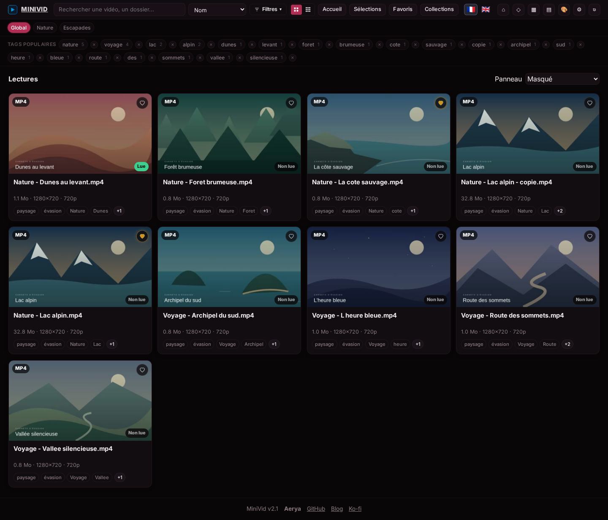
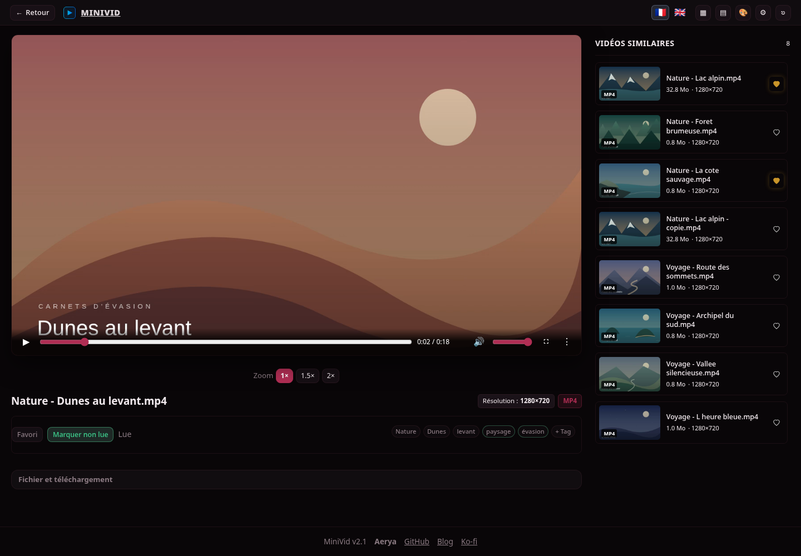
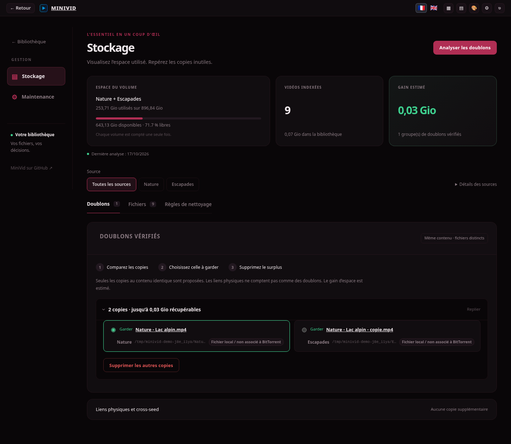
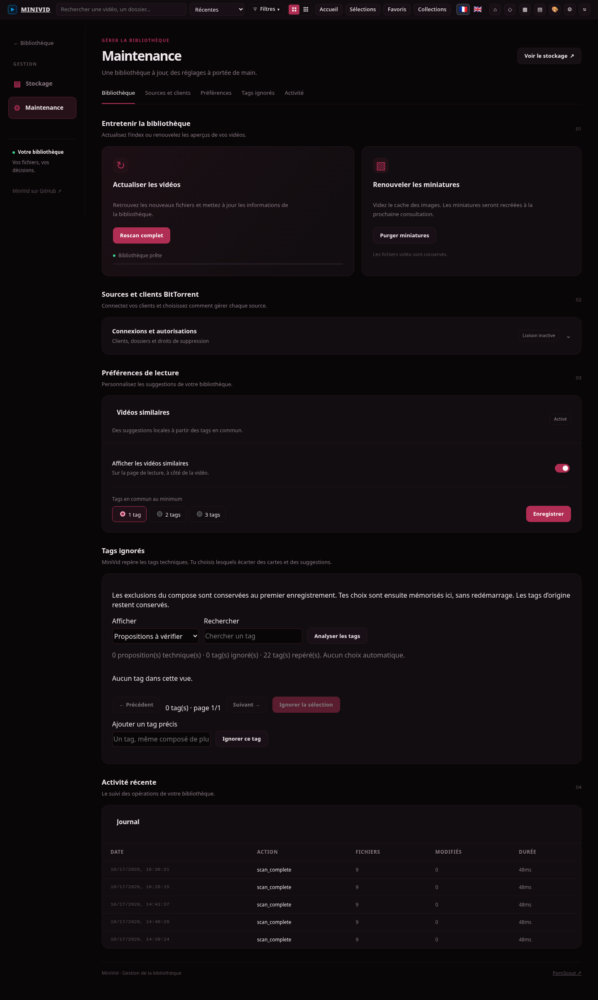

<p align="center">
  
</p>
<h1 align="center">MiniVid</h1>
<p align="center"><strong>Your video folders, made easy to browse.</strong><br>A personal video library you host yourself.</p>
<p align="center"><strong>English</strong> · <a href="README.fr.md">Français</a></p>
<p align="center"><a href="#features">Features</a> · <a href="#installation">Installation</a> · <a href="#gpu">GPU</a> · <a href="#storage">Storage</a> · <a href="#screenshots">Screenshots</a> · <a href="#documentation">Documentation</a></p>



## Features

- **Browse** your videos: folders, search, tags and favorites.
- **Watch** in a browser, with playback resume and fullscreen.
- **Rediscover** videos never played and find similar content.
- **Make space**: storage usage, verified duplicates and confirmed deletion.
- **Customize** colors and themes. English and French interface.
- **Connect** qBittorrent or ruTorrent to view sharing information.

Statuses use actual watched time: **unwatched below 30%**, **in progress from 30% to below 70%**, **watched from 70%**. Manage ignored tags in **Maintenance**.

## Installation

On Linux with **Docker Engine 25+ and Docker Compose**:

```bash
git clone https://github.com/Aerya/MiniVid.git
cd MiniVid
./minivid.sh
```

Open **`http://SERVER_IP:8080`**. Put your videos in `./videos`, or edit `.env`:

```dotenv
MINIVID_MEDIA_PATH=/mnt/videos
```

Run `./minivid.sh` again after editing. Videos are mounted **read only** by default.

**Dockge:** use [`docker-compose.yml`](docker-compose.yml) and the [`.env` template](.env.example). [Multiple folders or password protection →](docs/configuration.md)

**Updating:** run `docker compose pull`, then `docker compose up -d`. Keep `data/`, which holds your settings and history.

## GPU

**Why?** Some videos need conversion before a browser can play them. A GPU can speed this up and reduce CPU work. It does not help with files played directly.

**How?** Choose a mode in `.env`, then restart MiniVid:

```dotenv
MINI_TRANSCODE=1
MINIVID_GPU=auto
# Replace auto with cpu to use the processor only.
```

NVIDIA needs the host driver and NVIDIA Container Toolkit. Intel/AMD needs access to `/dev/dri`. If the GPU is unavailable, MiniVid falls back to the CPU by default.

## Storage

**Storage → Scan for duplicates → choose the copy to keep.**

MiniVid compares file contents. Hardlinks and the `cross-seed-links` folder are not counted as additional copies. Space savings are estimated.

Deletion requires authentication and explicit permission. Automatic cleanup is **off by default**. [Configure clients and cleanup →](docs/configuration.md#deletion-and-cleanup)

## Screenshots

Captured with demonstration videos, without explicit content. The screenshots show the French interface.

| Playback | Storage |
| --- | --- |
| [](docs/screenshots/player-sharing.png) | [](docs/screenshots/storage.png) |



## Documentation

[Configuration and multiple sources](docs/configuration.md) · [Windows — assistant provided as is, untested by the maintainer](Windows-MiniVid.cmd) · [Report an issue](https://github.com/Aerya/MiniVid/issues) · [MIT license](LICENSE)

Videos and application data stay on your installation. HLS playback loads its JavaScript library from a CDN.

### Optional companion

MiniVid can display an external companion under **◇**. Connect both services to a private Docker network and set `MINI_EXTENSION_URL` and `MINI_EXTENSION_TOKEN` (same token on both sides, at least 24 characters). Administrator authentication is required. The companion can add tags without replacing your manual tags. No external service is contacted when these settings are absent.
